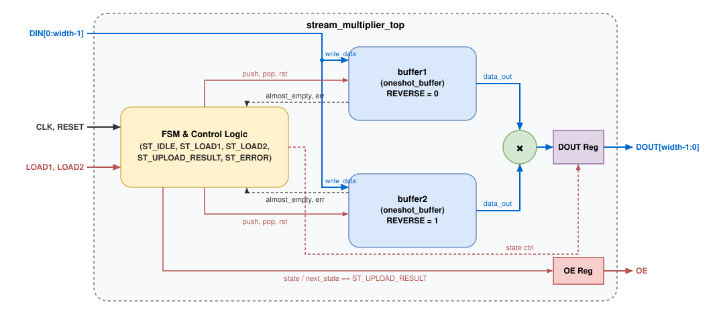

# Exercise

Design a device in Verilog that computes the product of two data streams. The input sequence must be "reversed" in time: the first sample of the first stream is multiplied by the last sample of the second stream, the second sample of the first stream is multiplied by the second-to-last sample of the second stream, and so on.

Each signal consists of 128 samples, with each sample being 8 bits wide.

Use the `load1` signal to write the first data stream into the device's internal memory, and the `load2` signal to write the second data stream. Once both streams have been loaded, the device performs the multiplication and outputs the result, signaled by the assertion of an `OE` (Output Enable) signal.

**For an "excellent" grade:** Implement checks on the amount of data being written.

If the input data array is already full but the `load1` or `load2` signals remain active, the device must assert an error signal, `err`.

If the `load1` or `load2` signal is deasserted before the array is completely filled, the remaining memory locations must be padded with zeros.

### Input signals:

* `CLK` - clock synchronization
* `LOAD1`, `LOAD2` - data load signals
* `RESET` - reset of the accumulator prior to accumulation
* `DIN[0:7]` - input data

### Output signals:

* `DOUT[7:0]` - accumulator output data
* `OE` - data generation flag

## Additional task

Write a **testbench** for this device, suitable for execution in ModelSim.

# Solution



The design I have implemented consists of the following:

- Two sample buffers (instances of `oneshot_buffer`): one configured as "forward" (`parameter REVERSE_BUFFER_MODE = 0`) and the other as "reverse" (`parameter REVERSE_BUFFER_MODE = 1`). These buffers receive and accumulate the incoming `DIN` data stream, which is subsequently passed to a multiplier. They require a reset after the reception and data-out phases are complete.
- An FSM (Finite State Machine) and control logic block—or rather, a set of blocks, implemented via several procedural blocks—that processes external signals and buffer status flags to generate control signals for the buffers, as well as the system's output signals.

# Project Structure

```
.
│   init.tcl    <----- Fix for RPCClient (for ModelSim in GUI mode)
│   README.md   <----- Repository description file
│   run_tb.bat  <----- Script to run verification (Windows cmd)
│   run_tb.sh   <----- Script to run verification (Linux shell)
├───extras      <----- Directory containing an alternative solution to the task
├───resources   <----- Resources (*.svg)
├───results     <----- Results from a testbench run
└───solution    <----- Directory containing the solution to the task
```

# How to run solution verification

#### Important: Before running, ensure that the directory containing the ModelSim executable files has been added to your `PATH` environment variable.

### Windows

Execute the `run_tb.bat` file from the command line:

```cmd
run_tb.bat
```

### Linux

Set the execution permission for the `run_tb.sh` file:

```bash
chmod +x ./run_tb.sh
```

Run `run_tb.sh`:

```
./run_tb.sh
```

P.S. The scripts have been tested with ModelSim version *Intel FPGA Edition 2020.1 Revision 2020.02*.